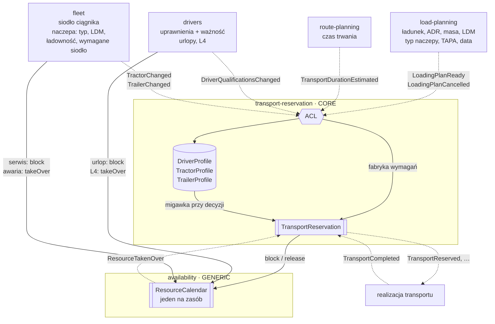
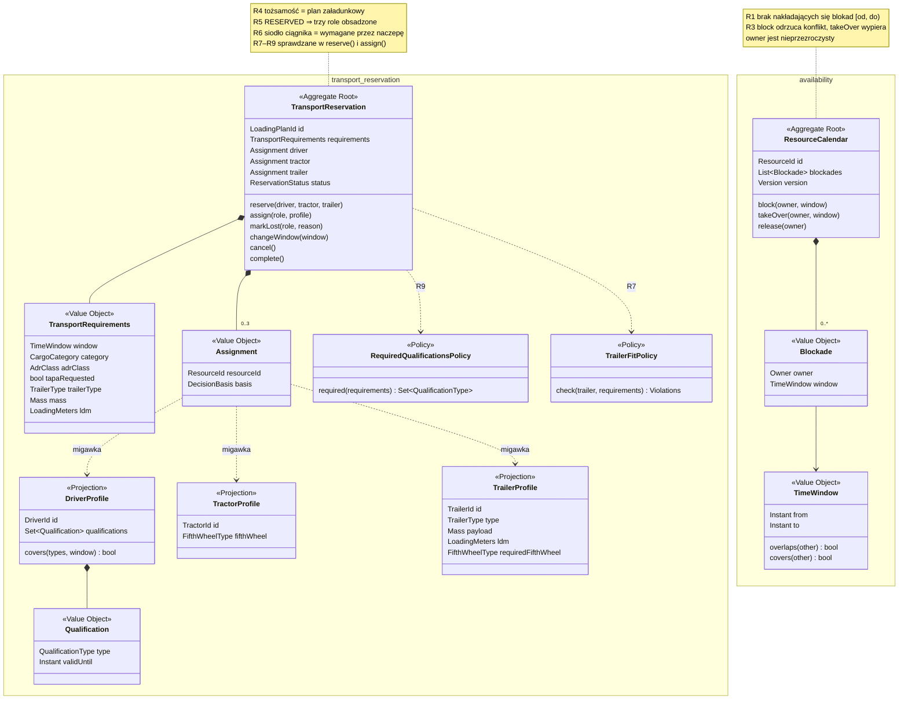
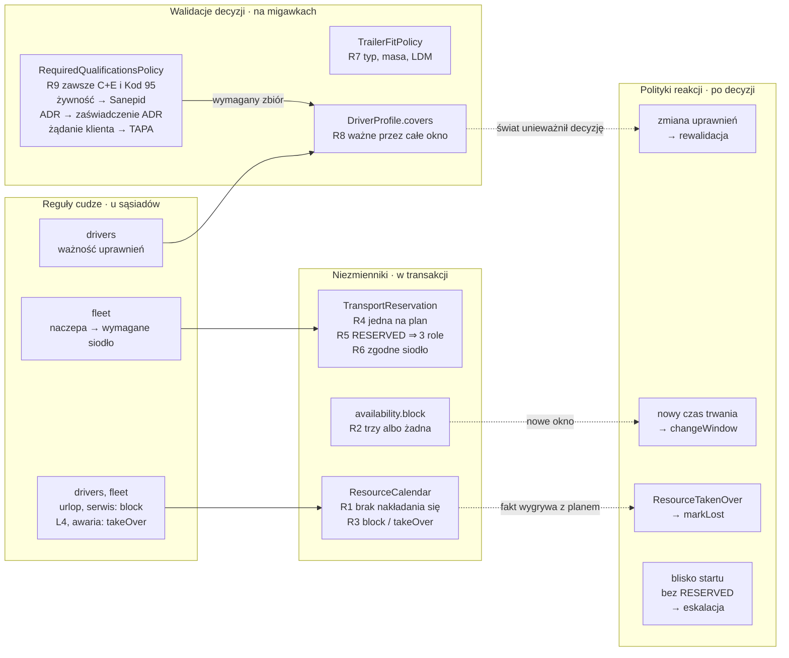
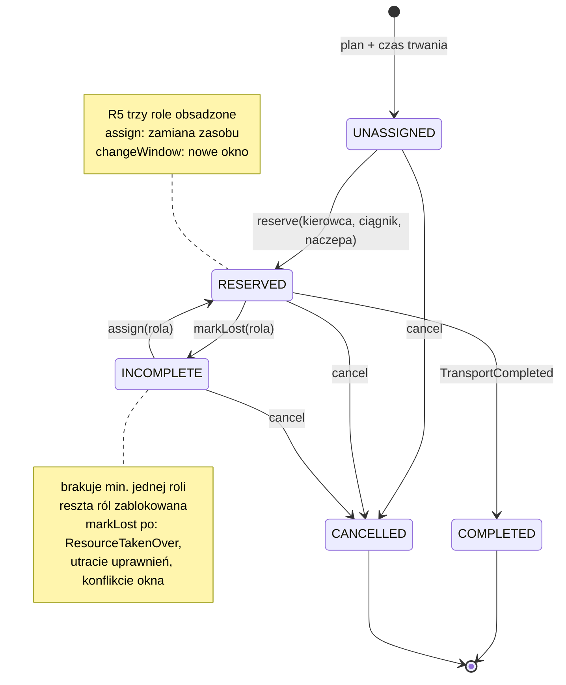
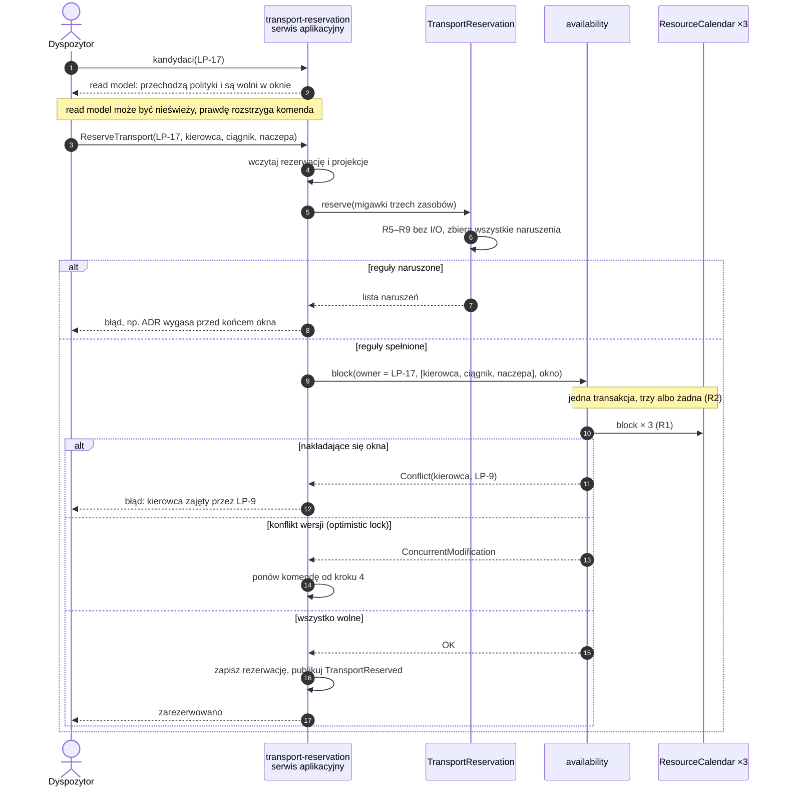
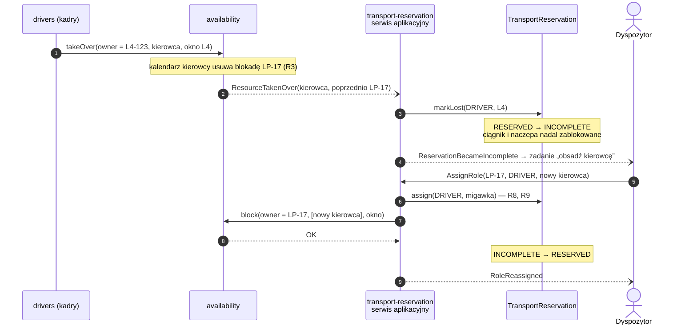

TMS · transport-reservation · model taktyczny

# Model transport-reservation

Rezerwacja przypisuje kierowcę, ciągnik i naczepę do planu załadunkowego na określone okno czasu. Model rozdziela dwa pytania o każdy zasób: czy się nadaje do tego ładunku i czy jest wolny w tym oknie. Każde z nich ma własną granicę spójności.

## Najważniejsze decyzje

1. Dwie granice spójności `ResourceCalendar` pilnuje, żeby zasób nie był w dwóch miejscach naraz. `TransportReservation` pilnuje kompletności przydziału i jego zgodności z wymaganiami ładunku.
2. Kalendarz w osobnym module Do kalendarza piszą trzy moduły: rezerwacje, kadry i flota. Dlatego mieszka w generycznym module `availability`, a nie w rezerwacji.
3. Uprawnienia to kwalifikowalność Wygasły ADR wyklucza z transportów ADR, ale nie blokuje kalendarza. Ważność sprawdzamy dla całego okna, na migawkach danych z `drivers`.
4. Fakt wygrywa z planem L4 i awaria wypierają rezerwację. Rezerwacja przechodzi w `INCOMPLETE` i trzyma pozostałe zasoby, a dyspozytor dostaje zadanie obsadzenia roli.
5. Wymagania to suma cech Kategoria ładunku, klasa ADR i żądanie TAPA od klienta są od siebie niezależne. Wymagane uprawnienia to suma zbiorów wyliczonych z każdej z tych cech.
6. Siodło to fakt floty Naczepa MEGA ma 3 m wysokości wnętrza i mieści się w limicie 4 m tylko z ciągnikiem LOW_DECK. Mapowanie naczepy na wymagany typ siodła przychodzi z `fleet`, rezerwacja tylko porównuje.

## Granice modułów

Linia ciągła to wywołanie synchroniczne, przerywana to zdarzenie. Kadry i flota piszą do kalendarza bezpośrednio, więc konflikt nieobecności z rezerwacją rozstrzyga się w jednym miejscu, w jednej transakcji.

## Agregaty i granice spójności

Dwa agregaty w dwóch modułach, bez referencji między sobą. Kalendarz zna tylko nieprzezroczystego właściciela blokady, a rezerwacja tylko identyfikatory zasobów i migawki faktów, na których oparła decyzję.

## Reguły i ich miejsce

Cztery rodzaje reguł. Strzałki przerywane łączą to, co świat może unieważnić po decyzji, z polityką, która przywraca zgodność.

## Stan rezerwacji

Utrata jednej roli nie anuluje rezerwacji i nie zwalnia pozostałych zasobów. Anulowanie z każdego aktywnego stanu zwalnia wszystkie blokady.

## Rezerwacja krok po kroku

Reguły sprawdza agregat, bez wejścia-wyjścia. Trzy kalendarze blokujemy w jednej transakcji. Konflikt wersji jest ponawiany, konflikt okien trafia do dyspozytora jako błąd.

## Utrata zasobu po rezerwacji

L4 kierowcy wypiera rezerwację. Ciągnik i naczepa czekają zablokowane, a nowy kierowca przechodzi przez te same reguły co przy pierwszej rezerwacji.

## Otwarte pytania do eksperta

- Czy system ma pilnować czasu pracy kierowcy, czyli odpoczynku między transportami i limitów tygodniowych? Jeśli tak, to niezmiennik obejmujący wiele rezerwacji jednego kierowcy, więc kalendarz kierowcy dostaje własne reguły.
- Czy ciągnik LOW_DECK może ciągnąć zwykłą naczepę? Zmienia to tylko dane z `fleet` i porównanie w R6.
- Kto wygrywa: zatwierdzony urlop czy wcześniejsza rezerwacja? To wybór między `block` a `takeOver` po stronie kadr.
- Czy czas z route-planning obejmuje dojazd na załadunek i odpoczynki? Jeśli nie, okno blokady musi być szersze niż okno transportu.